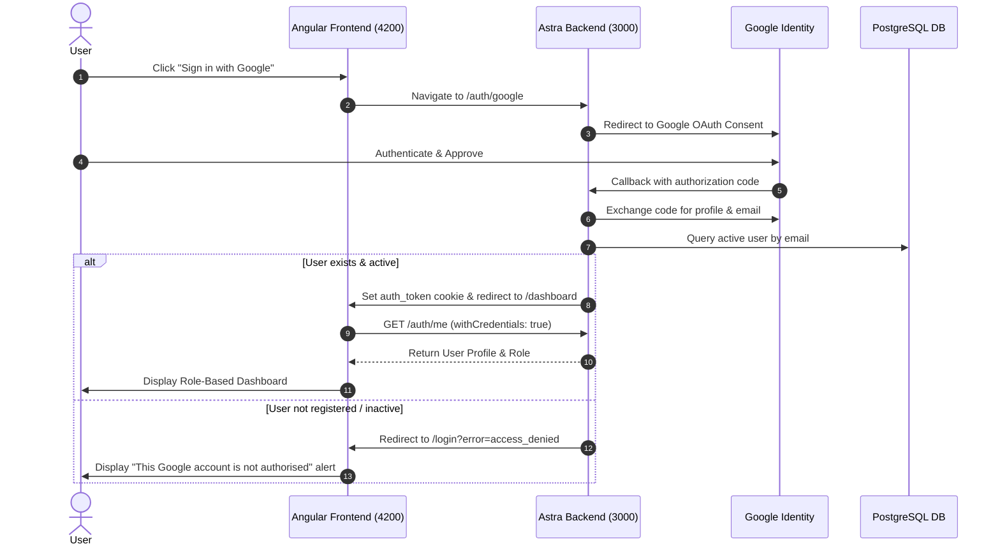

# Astra Frontend

Astra Frontend is a modern, responsive web application for the Astra Academic Portal built with **Angular 19** (Standalone Components), **PrimeNG 19**, and **Tailwind CSS**.

---

## Table of Contents
- [Features](#features)
- [Tech Stack](#tech-stack)
- [Prerequisites](#prerequisites)
- [Project Structure](#project-structure)
- [Environment Configuration](#environment-configuration)
- [Setup & Installation](#setup--installation)
- [Available Scripts](#available-scripts)
- [Authentication Flow](#authentication-flow)
- [Routing & Role-Based Route Guards](#routing--role-based-route-guards)
- [UI Components & Theming](#ui-components--theming)
- [Troubleshooting](#troubleshooting)

---

## Features
- **Modern Angular 19 Architecture**: 100% Standalone components and functional routing (no legacy `NgModule`).
- **Google OAuth Integration**: Direct authentication through backend Google OAuth flow with session cookies.
- **Role-Based Routing & Dashboards**: Dedicated UI views for `Student`, `Faculty`, and `Admin` users.
- **PrimeNG 19 Design System**: Styled with `@primeuix/themes` (Aura preset) and Tailwind CSS.
- **HTTP Interceptors**: Automatic `withCredentials: true` injection for secure cross-origin cookie sharing.
- **Graceful Error Handling**: PrimeNG alert banners and user feedback for unauthorized access attempts (`access_denied`).

---

## Tech Stack
- **Framework**: Angular 19 (Standalone Components, Signals, Functional Guards)
- **UI Component Library**: PrimeNG 19 (`primeng`, `@primeuix/themes`, `primeicons`)
- **Styling**: Tailwind CSS (v3), PostCSS, Autoprefixer
- **HTTP Client**: Angular `provideHttpClient` with functional interceptors
- **Polyfills**: Zone.js polyfill enabled in bootstrap

---

## Prerequisites
Before setting up the frontend, ensure you have:
1. **Node.js** (v18.0.0 or higher) - [Download Node.js](https://nodejs.org/)
2. **Angular CLI** (v19 or higher):
   ```bash
   npm install -g @angular/cli
   ```
3. **Astra Backend** running at `http://localhost:3000` (for authentication and API requests).

---

## Project Structure

```
frontend/
├── src/
│   ├── app/
│   │   ├── core/
│   │   │   ├── guards/
│   │   │   │   └── auth.guard.ts         # Functional CanActivateFn guard verifying auth and roles
│   │   │   ├── interceptors/
│   │   │   │   └── http.interceptor.ts   # Appends withCredentials to all API requests
│   │   │   ├── models/
│   │   │   │   └── user.model.ts         # TypeScript models (User, Role, AuthState)
│   │   │   ├── providers/
│   │   │   │   └── error-listeners.provider.ts # Global error handling listeners
│   │   │   └── services/
│   │   │       └── auth.service.ts       # Authentication state, login, me, and logout calls
│   │   ├── features/
│   │   │   ├── auth/
│   │   │   │   └── login.component.ts    # Clean login page with Google sign-in button & alerts
│   │   │   └── dashboard/
│   │   │       └── dashboard.component.ts# Dashboard dynamically rendered by user role
│   │   ├── shared/                       # Reusable UI widgets and directives
│   │   ├── app.component.ts              # Root shell component
│   │   ├── app.config.ts                 # App providers (PrimeNG Aura theme, HttpClient, Router)
│   │   └── app.routes.ts                 # Application route declarations
│   ├── environments/
│   │   ├── environment.ts                # Development environment (API URL)
│   │   └── environment.prod.ts           # Production environment
│   ├── index.html                        # Application entry HTML
│   ├── main.ts                           # Application bootstrap (imports zone.js)
│   └── styles.css                        # Tailwind CSS imports & PrimeNG theme rules
├── angular.json                          # Angular workspace configuration
├── package.json                          # Dependencies and scripts
├── postcss.config.json                   # PostCSS configuration for Tailwind
├── tsconfig.app.json                     # Application TypeScript compiler settings
├── tsconfig.json                         # Root TypeScript configuration
└── README.md                             # Documentation
```

---

## Environment Configuration

The application configuration is managed under `src/environments/`:

```typescript
// src/environments/environment.ts
export const environment = {
  production: false,
  apiUrl: 'http://localhost:3000'
};
```

Ensure `apiUrl` matches the address of your running Astra Backend instance.

---

## Setup & Installation

1. **Clone the repository:**
   ```bash
   git clone https://github.com/rohit-pu/Astra_Frontend.git
   cd Astra_Frontend
   ```

2. **Install project dependencies:**
   ```bash
   npm install
   ```

3. **Start the local development server:**
   ```bash
   npm start
   # or
   ng serve
   ```

4. **Open in browser:**
   Navigate to `http://localhost:4200/`.

---

## Available Scripts

| Command | Description |
| :--- | :--- |
| `npm start` or `ng serve` | Runs dev server at `http://localhost:4200/` with hot-reloading |
| `npm run build` or `ng build` | Compiles production-ready bundle into `dist/` |
| `npm test` or `ng test` | Runs unit tests via Karma / Jasmine |

---

## Authentication Flow



---

## Routing & Role-Based Route Guards

Routes are defined in `src/app/app.routes.ts`:

- `/login`: Public login page.
- `/dashboard`: Protected by `authGuard`. Displays dashboard based on user role (`Student`, `Faculty`, `Admin`).
- `**`: Wildcard redirecting to `/login`.

The `authGuard` functional guard (`src/app/core/guards/auth.guard.ts`):
1. Calls `authService.checkAuth()` to verify the session with the backend.
2. If authenticated, grants access to the route.
3. If not authenticated, redirects to `/login`.
4. If role requirements are specified on the route (e.g., `data: { roles: ['Admin'] }`), ensures the active role is permitted.

---

## UI Components & Theming

PrimeNG 19 is configured in `src/app/app.config.ts`:

```typescript
import Aura from '@primeuix/themes/aura';
import { providePrimeNG } from 'primeng/config';

export const appConfig: ApplicationConfig = {
  providers: [
    provideZoneChangeDetection({ eventCoalescing: true }),
    provideRouter(routes),
    provideHttpClient(withInterceptors([authInterceptor])),
    providePrimeNG({
      theme: {
        preset: Aura,
        options: {
          darkModeSelector: false || 'none'
        }
      }
    }),
    MessageService
  ]
};
```

---

## Troubleshooting

- **Blank screen with error `NG0908: In this configuration Angular requires Zone.js`**:
  - Ensure `import 'zone.js';` is the first import in `src/main.ts`.
- **CORS / Cookie authentication issues**:
  - Ensure the backend allows `http://localhost:4200` with `credentials: true`.
  - Ensure Angular requests are configured with `withCredentials: true` via `http.interceptor.ts`.
- **Styling or theme not rendering**:
  - Verify that `primeicons/primeicons.css` and Tailwind directives (`@tailwind base;`, `@tailwind components;`, `@tailwind utilities;`) are present in `src/styles.css`.
